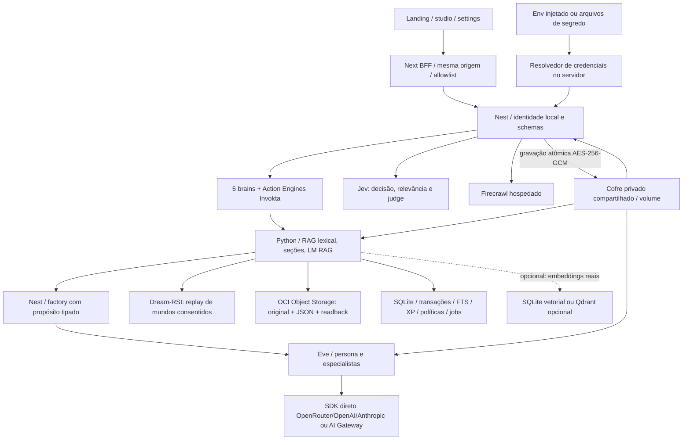
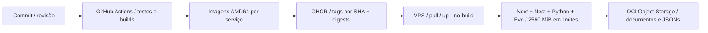

# Atlas 0.4 — conexões, credenciais e entrega

Atualização arquitetural de 24/10/2026. A entrada `/workspace` e a landing editorial da equipe (`ca87c9e`) foram integradas; `/studio` continua como alias. O painel funciona em ambos os caminhos de estúdio, no sufixo `/settings`. Complementa a Agent Factory 0.3 e incorpora landing Atlas, identidade pessoal, fontes de credenciais e build fora da VPS. O Dreamer continua núcleo. Agente, método, formato e provedor são escolhas independentes.

## Fontes de credenciais

1. **Gerenciadas:** variáveis injetadas ou arquivo montado pelo operador. `NOME_FILE` tem prioridade sobre `NOME`; arquivo configurado e indisponível falha explicitamente. Isso integra o aplicativo a um secret manager via entrega de arquivo, sem fingir que o Atlas criou ou chamou um serviço Vault.
2. **Manuais:** o painel envia a chave uma vez ao BFF; Nest valida finalidade/provedor e grava um envelope AES-256-GCM com nonce aleatório, AAD de versão/tenant e escrita atômica. A chave mestra vem de env/arquivo separado do volume. Nenhuma API retorna a chave; o navegador não a persiste. São quatro finalidades: geração, decisão/judge, busca e embeddings opcionais.
3. **Login local:** `chatgpt()` nativo do Eve usa o fluxo `/login` do desenvolvimento local, habilitado explicitamente pelo operador. Não é login de usuários no Atlas e não é API OpenAI para uma assinatura ChatGPT. A configuração é recusada em produção; não copiamos cookies nem usamos a autenticação do agente que desenvolve o projeto.

Manual sobrescreve a fonte gerenciada para a mesma finalidade. Remover a configuração manual restaura a fonte do servidor. O painel declara `configured_not_verified`: uma chave preenchida não comprova acesso. O teste opcional consulta somente catálogo OpenAI/OpenRouter/Anthropic; não envia fontes nem gera conteúdo, e não comprova compatibilidade de ferramentas/JSON.

## Distribuição e consistência

Nest escreve `ATLAS_DATA_DIR/credentials/providers.enc`; Python e Eve leem o mesmo volume. API, Python e Eve usam UID 10001 nos containers para permitir leitura do arquivo 0600/diretório privado. Next não monta esse volume nem recebe a chave mestra. A chave mestra precisa ser igual nos leitores e guardada separadamente no backup.

Python fixa um snapshot de configuração durante ingestão, geração, job e reindexação. A troca de modelo não mistura embeddings num mesmo lote. Índices incluem endpoint/modelo e exigem reindexação quando a identidade muda. A API bloqueia alterações de conexões durante uma sessão ativa da factory. O resolvedor dinâmico de modelo do Eve usa os SDKs na camada confiável, fora dos prompts e estado durável.

O volume continua sendo um workspace local único. Antes de uso público, credenciais precisam de isolamento por usuário, autorização de administração e escopos por tenant autenticado. Não oferecer este painel na Internet com o controle local atual.

## Busca sem serviço dedicado

A configuração cotidiana não exige embeddings externos: FTS, representação lexical local e contexto de seções/documentos, com Jev para classificar relevância quando configurado. Isso não é embedding semântico. O Jev não substitui um gerador de vetores. O caminho semântico opcional permanece para o aceite do edital e consultas que precisarem dele. Não existe nova instância, modelo local pesado ou dependência de Qdrant para o padrão.

## Entrega fora da VPS

Workflows não recebem chaves de modelos ou OCI. `GITHUB_TOKEN` com packages:write é usado apenas na publicação manual em `main`. PRs não publicam imagens. Não há SSH automático nem criação de VM. `compose.deploy.yaml` só referencia imagens prontas; `scripts/deploy-pull.sh` exige SHA imutável e executa pull/healthchecks sem build.

GHCR guarda software, não documentos privados, bancos ou backups. OCI Object Storage guarda os dados exigidos pelo edital. OCIR é alternativa de registry, sem obrigação no documento e sujeito a cotas/custos. Os limites de RAM mantêm a meta, mas precisam de medição sob IA real. Guia operacional: `docs/CONFIGURACAO_E_DEPLOY.md`.

## Ciclo de vida das fontes

Remoção transacional, outbox durável, destinos originais, reconciliação legada e
escolha automática de tutor estão descritos em [source-lifecycle.md](source-lifecycle.md).
O estúdio conserva as opções manuais em “Personalizar este estudo”. As configurações
existentes continuam suficientes; a mudança não adiciona chaves ou serviços obrigatórios.
