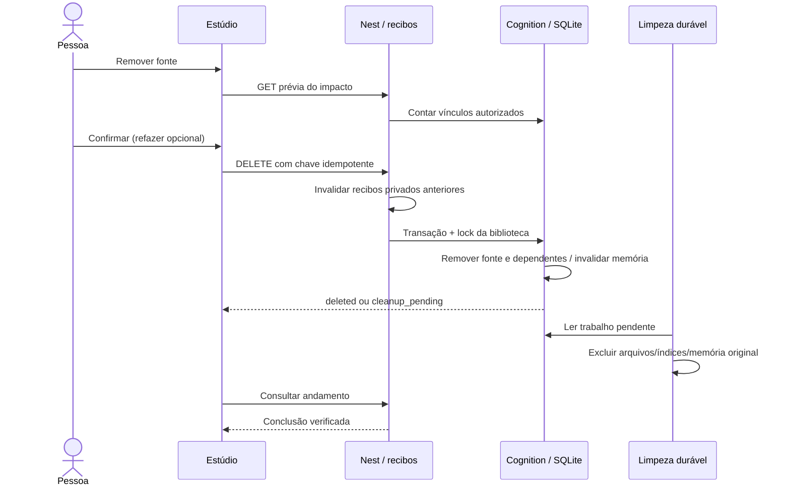

# Operar remoção de fontes e escolha automática

O estúdio começa em fontes + objetivo + “Criar meu material”. O backend valida as
fontes, resolve o tutor automático pelo Jev (ou pela política local identificada)
e mantém a execução nas capacidades tipadas do Invokta. Personalizar o estudo é
opcional; escolher manualmente um tutor continua tendo prioridade.



## Onde mexer

- `services/cognition/atlas/documents`: política de vínculos, transação de exclusão,
  limpeza de arquivos/índices, memória, locks, contratos HTTP e reconciliação.
- `atlas/study_request.py`: receita pública usada para refazer somente o material aberto.
- `apps/api/src/orchestration/routing.ts`: escolha de tutor com IDs limitados;
  `brains.ts` valida fontes antes de consultar memória ou classificação.
- `apps/api/src/commands`: invalidação de recibos e proteção de replay.
- `apps/web/components/source-removal.tsx`: confirmação, acompanhamento e recuperação
  visual; `studio-options.tsx`: controles avançados. A UI não decide a exclusão.

## Atualização e rollback

Faça backup privado do volume antes da atualização e mantenha as versões anteriores
por SHA. Store aplica migrações aditivas: integrations nas fontes e tabelas de outbox,
memória externa e deduplicação de reset. A migração não envia dados a terceiros.
Não restaure backup antigo para “desfazer” uma remoção sem avaliar consentimento e
retenção: isso pode reintroduzir dados apagados. Rollback de código não remove as
colunas/tabelas novas. Todos os processos escritores precisam usar a mesma versão.
Locks usam flock: operação suportada em Linux/containers no mesmo volume persistente;
não distribua dois SQLite independentes ou escritores antigos que ignorem os locks.

## Quando aparecer “administrador”

1. A fonte já saiu do acervo ativo; não prometa limpeza externa concluída.
2. No servidor privado, verifique o payload da operação em document_removals, usando
   tenant e ID exatos. Ele contém recibos/identidades, não o conteúdo do documento.
3. Confira registros históricos de buckets, coleções, projeções e memória. Não chute
   o destino usando apenas a configuração atual. Nunca coloque tokens no manifesto.
4. Prepare um arquivo privado de manifesto. O exemplo abaixo declara **somente após
   conferência real** que a fonte legada não teve projeções externas. Se teve, inclua
   as identidades reais nos campos descritos em seguida.

```json
{
  "tenant": "local-workspace",
  "document_id": "doc_0123456789abcdef0123",
  "reviewed_all_historical_destinations": true,
  "oci": [],
  "collections": [],
  "mongo_origin": null,
  "memory_origins": []
}
```

Para OCI, cada entrada inclui object_key do recibo, namespace e bucket originais.
Para Qdrant, cada entrada inclui name da coleção e origin (SHA256 do QDRANT_URL sem
barra final). Mongo usa o fingerprint produzido por atlas.projections.origin() com
a configuração histórica restaurada. Memória usa atlas.documents.memory.origin().
São identidades, não chaves. Destinos já conhecidos não podem ser sobrescritos.
A CLI exige acesso administrativo ao volume; nunca a exponha como recurso do usuário.

```bash
# No ambiente do cognition, com ATLAS_DATA_DIR e credenciais históricas corretos:
cd services/cognition
../../.venv/bin/python -m atlas.documents.reconcile \
  --tenant local-workspace \
  --document-id doc_0123456789abcdef0123 \
  --manifest /caminho/privado/manifesto.json
```

A reconciliação registra hash/data do manifesto e libera nova tentativa. Não marca
apagado. O worker verifica os serviços reais; indisponibilidade mantém a pendência.
Se houver várias origens, restaure suas configurações sucessivamente, sem substituir
as identidades no payload. Não edite status para deleted nem apague linhas do outbox.
Os tombstones conservam IDs e contagens, sem conteúdo; são necessários para retry.
Backups, provedores e streams históricos exigem política de retenção separada.

## Verificação reproduzível

`npm test`, `npm run typecheck`, `npm run quality`, `npm run check:env`, `npm run build`
e `ATLAS_E2E_CHROMIUM=/usr/bin/chromium npm run test:e2e`. A suíte cobre transações,
isolamento, replay, corridas com geração/trilhas/Dreamer, reinício, falhas e destinos
originais. E2E usa Next/Nest/Python reais no fluxo normal em desktop e mobile; o caso
de UI pendente usa fixture declarada. HTTP 202 é testado no controller real. Serviços
pagos/OCI/Jev têm doubles: aceite com credenciais reais continua sendo operacional.
